<!-- Header -->
<p align="center">
  
</p>

<p align="center">
  <a href="https://github.com/brunoM-all">
    
  </a>
</p>

<p align="center">
  <a href="https://www.linkedin.com/in/"></a>
  <a href="mailto:bruno.martinez@allcomtelecom.com"></a>
  
</p>

<br/>

## 👨‍💻 Sobre mim

```ts
const bruno = {
  role:      "Software Developer @ Allcom Telecom",
  location:  "Brasil 🇧🇷",
  building:  ["Plataforma IoT (AllManager)", "Agentes de IA", "Apps mobile"],
  stack:     ["TypeScript", "Java", "Python", "Dart/Flutter"],
  learning:  ["Arquiteturas multi-agente", "Edge & IoT em escala"],
  funFact:   "Se dá pra automatizar, vira agente 🤖",
};
```

## 🛠️ Stack

<p align="center">
  <br/>
  <br/>
  
</p>

## 📊 Em números

<p align="center">
  <picture>
    <source media="(prefers-color-scheme: dark)" srcset="./assets/overview-dark.svg" />
    <source media="(prefers-color-scheme: light)" srcset="./assets/overview-light.svg" />
    
  </picture>
</p>

<p align="center">
  <picture>
    <source media="(prefers-color-scheme: dark)" srcset="./assets/languages-dark.svg" />
    <source media="(prefers-color-scheme: light)" srcset="./assets/languages-light.svg" />
    
  </picture>
  <picture>
    <source media="(prefers-color-scheme: dark)" srcset="./assets/rhythm-dark.svg" />
    <source media="(prefers-color-scheme: light)" srcset="./assets/rhythm-light.svg" />
    
  </picture>
</p>

## 🚀 Projetos em destaque

<table>
  <tr>
    <td width="50%" valign="top">
      <h3>🤖 <a href="https://github.com/brunoM-all/boop-agent">boop-agent</a></h3>
      <p>Agente pessoal via iMessage com Claude Agent SDK ou Codex: memória, sub-agentes, automações e integrações.</p>
      
      
    </td>
    <td width="50%" valign="top">
      <h3>📈 <a href="https://github.com/brunoM-all/grafico-api">grafico-api</a></h3>
      <p>API para geração de gráficos a partir de dados.</p>
      
      
    </td>
  </tr>
  <tr>
    <td width="50%" valign="top">
      <h3>🥗 <a href="https://github.com/brunoM-all/flask---dieta">flask---dieta</a></h3>
      <p>Aplicação web de controle de dieta construída com Flask.</p>
      
      
    </td>
    <td width="50%" valign="top">
      <h3>📡 AllManager IoT <sub>(privado)</sub></h3>
      <p>Plataforma de gestão de dispositivos IoT com app mobile em Flutter e backend em Java.</p>
      
      
    </td>
  </tr>
</table>

## 🐍 Contribuições

<p align="center">
  <picture>
    <source media="(prefers-color-scheme: dark)" srcset="https://raw.githubusercontent.com/brunoM-all/brunoM-all/output/snake-dark.svg" />
    <source media="(prefers-color-scheme: light)" srcset="https://raw.githubusercontent.com/brunoM-all/brunoM-all/output/snake.svg" />
    
  </picture>
</p>

<p align="center">
  
</p>

<p align="center"><sub>Gráficos gerados diariamente por <a href="./.github/workflows/profile.yml">GitHub Actions</a> a partir da API GraphQL do GitHub.</sub></p>
